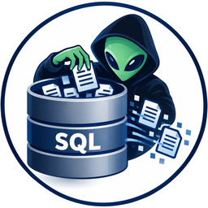

<p align="center"></p>

# sql-fk-finder

App desktop e notebook Jupyter per **trovare i collegamenti mancanti tra tabelle** di un database a partire dai file `.sql` con i `CREATE TABLE`.

Utile quando un database è stato creato senza chiavi esterne (`FOREIGN KEY`) e bisogna ricostruire le relazioni tra le tabelle guardando solo i nomi e i tipi delle colonne.

> **Manuale d'uso in PDF: [docs/Manuale_SQL_FK_Finder.pdf](docs/Manuale_SQL_FK_Finder.pdf)** — come si installa e si usa l'app, scheda per scheda, con gli screenshot.
>
> **Documentazione completa: [docs/](docs/README.md)** — introduzione, installazione e avvio, guida a tutte le pagine dell'app, come funzionano regole e algoritmi, codici della diagnostica, architettura (come comunicano le parti, perché l'app non usa la rete), riga di comando, domande frequenti.

## Cosa fa

1. Legge tutti i file `.sql` di una cartella ed estrae tabelle, colonne, tipi, chiavi primarie e chiavi esterne già dichiarate (anche quelle aggiunte con `ALTER TABLE`, come nei dump di PostgreSQL; le tabelle di schemi diversi da `public`/`dbo` restano distinte) (anche dai `CREATE TABLE` con `ENGINE=`, `COMMENT`, `PARTITION BY` e altra sintassi che `sqlglot` non riesce a leggere).
2. Mostra lo **schema iniziale**: com'è collegato il database prima dell'analisi, con un riepilogo e uno schema grafico (`schema_iniziale.html`).
3. Divide le tabelle in **gruppi di entità** con nomi simili (clustering gerarchico: `ordini`, `ordini_righe`, `tbl_ordini`...).
   Sopra i gruppi c'è un secondo livello, le **aree**: sottogruppi molto collegati tra loro dalle chiavi esterne (dichiarate e trovate ad affidabilità alta), trovati con un rilevamento di comunità. Le tabelle **centrali**, puntate da moltissime altre di sottogruppi diversi, pesano poco nella divisione, così non uniscono tutto in un'unica area. Per ogni area e sottogruppo si vedono i **collegamenti tra sottogruppi e tra aree** (numero di FK, 1:N / 1:1 / N:M, colonne), e ogni tabella riceve una **categoria** ricavata dalla struttura: codifica, anagrafica, movimento, dettaglio, ponte, storico, dipendente, isolata. Funziona su qualsiasi database: non usa nomi di tabelle precisi.
4. Trova le **colonne con lo stesso nome** in più tabelle.
5. Trova le **colonne con nomi simili** (`CODART` / `Cod_Articolo`).
6. Propone le **chiavi esterne candidate** con un livello di affidabilità:
   - **alta**: la colonna ha lo stesso nome della chiave primaria di un'altra tabella
   - **media**: il nome della colonna rimanda al nome di una tabella (`id_articolo` → `articoli`)
   - **alta (PK composta)**: la tabella contiene tutte le colonne della chiave primaria su più colonne di un'altra tabella (`id_ordine` + `num_riga` → `ordini_righe`)
7. Per ogni tabella con **chiave primaria composta** analizza le colonne della chiave una per una: cerca una tabella con il nome del campo (`codice` → `codici`), verifica che il campo ci sia e se lì è chiave primaria; altrimenti cerca le tabelle in cui il campo è chiave primaria.
8. Controlla che i tipi coincidano ed elenca le **tabelle isolate**.
   Controlla anche la **qualità dello schema** secondo le regole di progettazione dei database relazionali: tabelle senza chiave primaria (integrità dell'entità), tipo di ogni relazione (1:1, 1:N, N:M con tabelle ponte, obbligatoria o facoltativa), avvisi di normalizzazione (1NF, 2NF, 3NF) e relazioni ridondanti. Le chiavi esterne proposte hanno le regole `ON DELETE` / `ON UPDATE` scelte nelle impostazioni (integrità referenziale).
9. Permette di **togliere entità** dall'analisi: scrivendo `piatto` vengono tolte tutte le tabelle `piatti`, `piatto_ingredienti`... (anche un gruppo intero con un clic)
10. Salva i risultati e disegna uno **schema interattivo** dei collegamenti.

Tutto si può usare da una **interfaccia grafica** dentro il notebook (ultima sezione).

Con i dati nei file (`INSERT`, `COPY`) la pagina **Chiavi verificate sui dati** conta per ogni chiave esterna i valori che esistono nella tabella collegata e gli **orfani** (confermata, pochi orfani, dubbia, probabilmente sbagliata), trova i collegamenti che i nomi non rivelano guardando i valori e fa il **profilo** di ogni colonna (tabelle vuote, colonne sempre vuote, possibili ENUM con i loro valori). **Viste e procedure** mostra la **matrice CRUD** di viste, procedure, funzioni e trigger; **Codice generato** produce i **modelli SQLAlchemy** e una bozza di **script di normalizzazione** (1NF, 2NF, 3NF).

Nell'app ci sono anche le pagine **File della cartella** e **File XML**: tutti i file della cartella (sottocartelle comprese) da cercare per nome (`ordini.sql` mostra prima i file con lo stesso nome, `*.xml` è un modello) o per contenuto, da leggere a pezzi anche se enormi e da **affiancare** alla scheda di reverse engineering di una tabella, allo schema delle tabelle del file o al filo logico; i file XML si aprono come albero, con il riepilogo degli elementi e le tabelle e colonne del database che vi compaiono (per esempio nei mapping di un ORM). Dettagli in [docs/03-guida-all-uso.md](docs/03-guida-all-uso.md).

Nell'app c'è anche un **diagramma delle tabelle** in stile DBeaver: ogni tabella con le sue colonne (PK, FK, UQ e tipi), le linee dalla colonna chiave esterna alla chiave puntata con la cardinalità, disposizione automatica, zoom, trascinamento, ricerca, filtro per gruppo ed esportazione in SVG.

## Diagnostica: errori e avvisi come un compilatore

Tutti i controlli vengono riportati come l'output di un compilatore, con file e riga del `.sql`:

```
esempio_5.sql:44: errore E010: la tabella log_accessi non ha una chiave primaria
    suggerimento: aggiungere una chiave artificiale: id_log_accessi INT NOT NULL AUTO_INCREMENT PRIMARY KEY
esempio_5.sql:24: avviso W301: fatture.ragione_sociale: dipendenza transitiva: fatture → id_cliente → clienti.ragione_sociale
    suggerimento: toglierla da fatture: si ricava da clienti con un join
```

| Gravità | Codici |
|---|---|
| **errore** | E001-E003 lettura dei file (parentesi non chiusa, tabella o colonna definita due volte) · E010-E011 chiave primaria mancante o su colonna inesistente · E020-E025 chiavi esterne dichiarate sbagliate (tabella o colonna inesistente, non puntano alla chiave, tipi diversi, tabella partizionata) |
| **avviso** | W026 FK su tabella MyISAM · W030 chiave esterna mancante · W031 tipi incompatibili · W033 colonna da chiave senza tabella · W034 relazione ridondante · W101-W103 prima forma normale · W201 seconda · W301 terza |
| **info** | I032 FK possibile (affidabilità media) · I035 tabella isolata · I036 tabella ponte N:M · I038 relazione facoltativa |

Da terminale, come un compilatore vero (codice di uscita 1 se ci sono errori, con `--werror` anche per gli avvisi):

```bash
python -m sqlfk.verifica esempi --senza-info
python -m sqlfk.verifica dump.sql --werror --togli piatto
```

Nell'app c'è la pagina **Problemi**: cliccando un problema si vede il punto del file con la riga evidenziata. Il report si scarica come `diagnostica.txt` ed è anche nel primo foglio dell'Excel.

## Regole di progettazione

Ogni errore e avviso appartiene a una regola per costruire bene un database relazionale, con spiegazione, correzione ed esempi (pagina **Regole di progettazione** dell'app, `sqlfk/regole.py`):

| Regola | Codici |
|---|---|
| R0 Codice SQL corretto e senza doppioni | E001-E003 |
| R1 Integrità dell'entità: ogni tabella ha una chiave primaria | E010-E011 |
| R2 Integrità referenziale: ogni chiave esterna punta a una riga che esiste | E020-E025, W026-W027 |
| R3 Ogni collegamento è una chiave esterna dichiarata | W030-W031, I032, W033 |
| R4 Niente relazioni ridondanti | W034 |
| R5 Relazioni e cardinalità (1:1, 1:N, N:M, obbligatorietà) | I035, I036, I038 |
| R6 Prima forma normale: valori atomici | W101-W103 |
| R7 Seconda forma normale: dipendere da tutta la chiave | W201 |
| R8 Terza forma normale: niente dipendenze transitive | W301 |

```bash
python -m sqlfk.verifica esempi --regole      # sotto ogni problema la regola violata
python -m sqlfk.verifica --spiega W301        # spiegazione della regola, con esempio sbagliato e corretto
```

## Ontologia

Dallo schema si genera un'ontologia **OWL** (`ontologia.ttl`, per Protégé) e un mapping **R2RML** (`mapping_r2rml.ttl`, per trasformare i dati in RDF con Ontop o RMLMapper): tabelle → classi al singolare, colonne → proprietà di dato, chiavi esterne → proprietà d'oggetto, chiavi primarie → `owl:hasKey`, `NOT NULL` → cardinalità minima, tabelle ponte → relazioni N:M. Pagina **Ontologia** dell'app, oppure:

```bash
python -m sqlfk.ontologia esempi --base http://example.org/negozio/
```

## Modello relazionale ed esportazioni

Lo schema logico del database (`Fatture (numero (pk), data, id_cliente (fk → clienti), importo)`), nella pagina **Modello relazionale** dell'app, si esporta come:

| Formato | Per cosa |
|---|---|
| **PNG**, **SVG** | immagine del diagramma delle tabelle |
| `.txt`, `.md` | schema logico in testo o Markdown |
| Mermaid `.mmd` | diagramma disegnato da GitHub, Notion, mermaid.live |
| PlantUML `.puml` | plantuml.com e plugin degli editor |
| Graphviz `.dot` | `dot -Tpng modello_relazionale.dot -o modello.png` |
| DBML `.dbml` | dbdiagram.io |
| JSON | struttura completa, per altri programmi |

```bash
python -m sqlfk.modello esempi --formato mermaid > modello.mmd
```

## File grandi (anche decine di GB)

I file si leggono a blocchi, senza caricarli interi in memoria:

- **analisi**: dei file sopra 64 MB si tiene solo la struttura (CREATE TABLE, ALTER TABLE, indici...) e si saltano i dati (INSERT, COPY). I numeri di riga di errori e avvisi restano quelli del file originale. Su un portatile un dump PostgreSQL da 1 GB si legge in circa 3 secondi e uno MySQL in circa 8, con circa 250 MB di memoria;
- **query**: con più di 256 MB di dati il database SQLite si costruisce su disco, nella cartella `~/.sqlfk/cache` (su Windows `C:\Users\nome\.sqlfk\cache`; si può cambiare con la variabile `SQLFK_CACHE`). Serve circa 1,2 volte lo spazio dei file. La costruzione richiede circa 30 secondi per GB per i dump PostgreSQL e 70 per quelli MySQL, mostra l'avanzamento e si può interrompere. Si fa una volta sola: con gli stessi file il database si riapre subito, anche dopo aver chiuso l'app;
- nell'app i file scelti con **Carica cartella** o **Carica file .sql** si leggono direttamente dal disco. Nel browser i file sopra 64 MB vanno aperti scrivendo il loro percorso (o quello della cartella) nel campo in alto;
- di ogni risultato si vedono le prime 1000 righe; **Scarica CSV completo** scarica tutte le righe, anche milioni. Una query lunga si ferma con **Interrompi**.

## Scelta delle chiavi con clingo (ASP)

La pagina **Scelta con clingo** (e la sezione 18 del notebook) usa [clingo](https://potassco.org/clingo/), un risolutore di Answer Set Programming, per scegliere l'insieme di chiavi esterne più coerente tra tutte le candidate. Le candidate diventano fatti e le regole sono nel file leggibile `sqlfk/regole_fk.lp`:

- le chiavi già dichiarate restano;
- le stesse colonne puntano al massimo a una tabella; due tabelle non si puntano a vicenda;
- si preferiscono le candidate ad affidabilità alta e quelle **confermate dall'interfaccia del programma** (se hai letto le sue schermate), e diventano candidate anche le relazioni che solo l'interfaccia mostra;
- si scartano tipi incompatibili, relazioni ridondanti (X → Z quando c'è X → Y → Z) e collegamenti di direzione incerta tra tabelle con la stessa chiave primaria (a meno che l'interfaccia li confermi).

Per ogni candidata scartata c'è il motivo; si vedono le differenze con la scelta automatica, si scaricano le chiavi scelte (`.sql`) e il programma ASP con i fatti (`.lp`, da usare anche con `clingo` da terminale). clingo è una libreria inclusa nell'app: tutto resta in locale. Da terminale: `python -m sqlfk.asp cartella [--medie] [--programma scelta.lp]`.

## Verifica con l'interfaccia di un programma (Windows)

Per un programma scaricato che usa il database (per esempio un gestionale per Windows), la pagina **Verifica con l'interfaccia** fa reverse engineering dall'interfaccia grafica, come un lettore di schermo, tutto in locale:

1. **scegli la finestra del programma** dall'elenco delle finestre aperte;
2. **leggi le schermate**: *Fai tutto da solo* (con un clic legge tutte le schede, analizza e salva rapporto HTML, rapporto di testo ed Excel in `Documenti/SQL FK Finder/rapporti/<programma data>`, con il pulsante per aprire la cartella), oppure *Leggi questa schermata*, *Leggi tutte le schede* (passa da solo tra schede e voci degli alberi di navigazione), *Registra mentre navigo* (legge ogni schermata che apri tu, anche le finestre secondarie). Con UI Automation si leggono etichette, campi, menu a tendina con le voci, griglie con intestazioni e righe, schede. Non preme mai pulsanti, non usa i comandi dei menu, non scrive nei campi; apre e richiude i menu a tendina solo per leggerne le voci;
3. **analizza**: ogni elenco, modulo o scheda diventa una classe (entità) con i suoi attributi, collegata a una tabella e alle colonne (per nome e, se il database delle query è pronto, per i valori mostrati). Le relazioni si riconoscono da menu a tendina, colonne i cui valori sono record di un'altra entità, elenchi dei figli dentro la scheda del padre (anche N:M tramite una tabella ponte), nomi di altre entità (indizio debole).

Il risultato si capisce a colpo d'occhio:

- una **sintesi** in parole semplici (schermate, entità, collegamenti, precisione delle previsioni);
- la **mappa del programma**: le entità con la tabella e le colonne collegate, e le frecce di come comunicano (verde = prevista e confermata, blu = già chiave esterna, rosso = usata dal programma ma non prevista, grigio = indizio debole);
- **come comunicano le parti**, schermata per schermata: una frase per ogni collegamento (per esempio *il menu a tendina «Regione» del modulo «Provincia» fa scegliere un record di regioni: ogni provincia è collegata a una regione...*), con l'istruzione SQL per aggiungere quelli mancanti;
- precisione e richiamo delle chiavi esterne previste, e le tabelle di dettaglio;
- **Scarica il rapporto (HTML)**: un file unico con testo e mappa da aprire senza rete, più i dettagli in Excel.

Le schermate lette si salvano nel file di progetto. La lettura delle finestre funziona su Windows (modulo `sqlfk/finestre.py`, con `comtypes`); l'analisi (`sqlfk/interfaccia.py`) funziona ovunque.

## Query sui dati

Dai file `.sql` si costruisce un database SQLite (in memoria, o su disco se i dati sono tanti: vedi sopra): le tabelle dei `CREATE TABLE` (più le colonne di `ALTER TABLE ... ADD COLUMN`) e i dati degli `INSERT INTO` e dei blocchi `COPY ... FROM stdin` dei dump di PostgreSQL. Nell'app c'è la pagina **Query sui dati**:

- elenco delle tabelle con il numero di righe e le colonne (clic sul nome: prime 100 righe; clic su una colonna: la inserisce nella query);
- editor delle query (Ctrl+Invio o Cmd+Invio per eseguire; se selezioni una parte viene eseguita solo quella), più istruzioni separate da `;`, query recenti;
- le query si scrivono in SQLite o nel dialetto dei file: se serve vengono tradotte con sqlglot (`ILIKE`, `::int`, `TOP 10`...); i nomi con lo schema (`public.clienti`) funzionano;
- INSERT, UPDATE, DELETE, DROP... chiedono conferma e cambiano **solo la copia in memoria**, non i file; "Ricarica i dati dai file" le annulla;
- risultati in tabella (fino a 1000 righe mostrate), scaricabili in CSV, anche completi; il database si scarica come file `.sqlite` (apribile con DBeaver) o come script SQL.

Da terminale:

```
python -m sqlfk.query esempi                                   # tabelle e numero di righe
python -m sqlfk.query esempi "SELECT * FROM comuni"
python -m sqlfk.query esempi --modifiche "DELETE FROM comuni WHERE id_comune = 1"
```

`esempi/dati_esempio.sql` contiene qualche riga di prova (solo INSERT, l'analisi non cambia).

## App desktop (gestionale)

Oltre al notebook c'è un'app con interfaccia grafica che fa le stesse cose: carichi i file `.sql` (una cartella intera o singoli file) e navighi tra panoramica, gruppi, schemi grafici, PK composte, FK candidate, entità da togliere e salvataggio dei risultati.

L'analisi è fatta in Python (modulo `sqlfk`, lo stesso usato dal notebook); l'interfaccia è una pagina web mostrata da Electron.

**Nessuna rete.** L'app non usa internet e non apre porte: l'interfaccia si carica da un protocollo interno (`sqlfk://app/`) ed Electron parla con Python attraverso le pipe del processo (`python -m sqlfk.ponte`, standard input e output). Ogni richiesta verso internet (http, https, websocket) è bloccata, anche gli schemi grafici sono tutti in locale. **Controllo dell'app.** Al primo avvio l'app si controlla da sola e dice com'è andata; poi si rifà quando vuoi con **Impostazioni → Controlla l'app**. Prova Python, librerie, analisi, query, lettura dei file e delle finestre (su una copia degli esempi: il lavoro aperto non cambia), verifica che internet sia bloccato e che l'app non abbia porte né connessioni aperte, mostra il risultato voce per voce e lo salva in `autoverifica.txt` nella cartella dei dati dell'app (pulsante *Apri la cartella*). Con la variabile `SQLFK_AUTOVERIFICA=1` fa il controllo, lo scrive anche in `sqlfk_autoverifica.txt` nella cartella temporanea e si chiude.

**Con un doppio clic**: `avvia_app.command` su Mac, `avvia_app.bat` su Windows (la prima volta scaricano Electron; su Mac, se il sistema blocca il file: tasto destro → Apri).

**Come app desktop (Electron)** — serve Node.js 18 o più recente:

```bash
cd app
npm install
npm start
```

Dalla cartella del progetto l'app usa un Python del computer con le librerie installate (`pip install -r requirements.txt`: `python3`, Anaconda, Homebrew...). Gli eseguibili invece hanno Python già dentro (vedi sotto). Se usi un Python in un percorso particolare, indicalo con la variabile `SQLFK_PYTHON`:

```bash
SQLFK_PYTHON=/percorso/del/python npm start
```

### Eseguibili per Mac, Windows e Linux

Per avere l'app come un programma normale (senza Node.js sul computer dove la usi), si creano gli eseguibili dal terminale:

```bash
./crea_eseguibili.sh
```

Da un Mac crea tutti e tre (Mac Apple Silicon e Intel, Windows, Linux); da Linux quelli per Linux e Windows; su Windows c'è `crea_eseguibili.bat` (solo Windows). Si può anche sceglierne alcuni: `./crea_eseguibili.sh mac`, `./crea_eseguibili.sh win linux`. La prima volta scarica gli strumenti (serve Node.js e internet). I file finiscono sul Desktop, nella cartella **SQL FK Finder - eseguibili**:

| Sistema | File | Come si usa |
|---|---|---|
| Mac | `SQL FK Finder.app`, `...-mac-arm64.dmg`, `...-mac-x64.dmg` | doppio clic; la prima volta clic destro → Apri (l'app non è firmata) |
| Windows | `...-win-x64.exe` (installazione), `...-portatile.exe` | doppio clic; se SmartScreen lo blocca: "Ulteriori informazioni" → "Esegui comunque" |
| Linux | `...-linux-x86_64.AppImage`, `...-linux-x64.tar.gz` | doppio clic sull'AppImage, oppure da terminale `./SQL-FK-Finder-...AppImage` |

Gli eseguibili contengono **Python con tutte le librerie** (Python embeddable di python.org per Windows, python-build-standalone per Mac e Linux, preparati da `app/prepara_python.py` con versioni fisse): sul computer dove si usa l'app non serve installare niente e l'app non va mai in rete. Internet serve solo sul computer dove si creano gli eseguibili, per scaricare una volta Electron, il Python da includere e le librerie (anche per gli altri sistemi). Per crearli servono Node.js e un Python 3 con pip.

Nel browser (comando qui sotto) invece c'è un piccolo server locale su `127.0.0.1`: è comodo per lavorare dal terminale, ma l'app non lo usa.

**Nel browser**, senza Electron:

```bash
python -m sqlfk.server --apri
```

e si apre `http://127.0.0.1:8765`. Con `--cartella percorso/dei/file` carica subito una cartella.

### Editor del database

L'interfaccia ha in alto una **barra a schede come Word** (Home, Analisi, Reverse engineering, Diagrammi, Dati, Esporta, Guida), ognuna con i suoi gruppi di pulsanti; la pagina **Come si usa** spiega ogni pulsante.

La pagina **Schema E-R** ricostruisce lo schema concettuale del database (entità, relazioni con il rombo e un nome proposto, N:M dalle tabelle ponte, gerarchie ISA, attributi multivalore), da modificare e portare nell'Editor. La pagina **Dati delle tabelle** mostra struttura, righe e **grafici** dei dati (istogrammi, andamento delle date, valori più frequenti) di ogni tabella popolata e, cliccando una riga, le righe collegate (a cosa punta e chi punta a lei), da seguire da una tabella all'altra; **Peso delle tabelle** elenca tutte le tabelle, anche le vuote, con righe e spazio, per togliere quelle che non servono.

La pagina **Disegno affiancato** mette il diagramma del database accanto a una lavagna bianca: si cliccano le tabelle da copiare (con colonne e collegamenti), si migliora il disegno, lo si scarica in un file `.json` e lo si riapre per continuare.

Nella pagina **Editor del database** si disegna un database da zero, oppure si importa quello caricato per correggerlo:

- **entità** con i loro attributi (nome, tipo, chiave primaria, NOT NULL, UNIQUE);
- **relazioni** tra entità, trasformate secondo le regole del passaggio dal modello E-R a quello logico: **1:N** aggiunge la chiave esterna nell'entità dal lato N, **1:1** la rende anche UNIQUE, **N:M** crea la tabella ponte con le due chiavi come chiave primaria (e gli attributi della relazione); *obbligatoria* rende la chiave esterna NOT NULL;
- il codice **SQL** (CREATE TABLE con chiavi e regole ON DELETE/ON UPDATE) si aggiorna mentre si disegna e si scarica; c'è anche il **PNG** del disegno;
- con **Analizza questo schema** tutte le altre pagine (Problemi, Regole, Ontologia, Modello relazionale, esportazioni) lavorano sul database disegnato.

Il disegno si salva nel file di progetto.

### File di progetto (.sqlfk)

Con **Salva progetto** l'app crea un file `.sqlfk` con tutto il lavoro: i file `.sql` caricati (dentro il progetto, quindi si riapre anche se la cartella originale non c'è più), le impostazioni (dialetto, soglie, colonne generiche, sinonimi, regole ON DELETE/ON UPDATE), le tabelle tolte, la disposizione del diagramma (le tabelle spostate a mano tornano dove le avevi lasciate) e il database disegnato nell'editor. Con **Apri progetto** si riprende da lì. È un file JSON; non va messo su GitHub se contiene dati riservati (è già nel `.gitignore`).

### Struttura del progetto

| Percorso | Contenuto |
|---|---|
| `collegamenti_tabelle_sql.ipynb` | il notebook, con le spiegazioni sezione per sezione |
| `sqlfk/analisi.py` | tutta l'analisi: lettura dei file, gruppi, chiavi primarie, FK candidate, salvataggio |
| `sqlfk/grafici.py` | gli schemi grafici interattivi |
| `sqlfk/server.py` | il server locale con le API usate dall'interfaccia |
| `sqlfk/verifica.py` | il controllo da terminale, come un compilatore |
| `sqlfk/regole.py` | le regole di progettazione collegate ai codici della diagnostica |
| `sqlfk/ontologia.py` | ontologia OWL e mapping R2RML |
| `crea_eseguibili.sh`, `crea_eseguibili.bat` | creano gli eseguibili dell'app per Mac, Windows e Linux |
| `sqlfk/estensioni.py` | chiavi verificate sui dati, collegamenti dai valori, profilo, matrice CRUD, modelli SQLAlchemy, script di normalizzazione |
| `sqlfk/esplora.py` | i file della cartella: elenco, ricerca per nome e nel contenuto, lettura a pezzi, file XML |
| `sqlfk/descrizione.py` | reverse engineering: cosa rappresenta ogni tabella, filo logico, dizionario dei dati |
| `sqlfk/asp.py`, `sqlfk/regole_fk.lp` | la scelta delle chiavi esterne con clingo (ASP) |
| `sqlfk/controllo.py` | il controllo dell'app |
| `sqlfk/finestre.py` | la lettura delle finestre di un programma Windows (UI Automation) |
| `sqlfk/interfaccia.py` | classi, collegamenti e verifica dalle schermate lette, con il racconto e la mappa |
| `sqlfk/ponte.py` | il collegamento tra l'app e Python con le pipe, senza rete |
| `app/prepara_python.py` | prepara il Python con le librerie da includere negli eseguibili |
| `sqlfk/lettura.py` | la lettura a blocchi dei file .sql di qualsiasi dimensione |
| `sqlfk/query.py` | il database SQLite in memoria costruito dai file e l'esecuzione delle query |
| `sqlfk/modello.py` | modello relazionale ed esportazioni (testo, Mermaid, PlantUML, DOT, DBML, JSON) |
| `sqlfk/web/` | l'interfaccia (HTML, CSS, JavaScript) |
| `sqlfk/web/estensioni.js` | le pagine Chiavi verificate sui dati, Viste e procedure, Codice generato |
| `sqlfk/web/file.js` | le pagine File della cartella (esplora, ricerca, schemi affiancati) e File XML (albero, riepilogo, tabelle del database) |
| `sqlfk/web/editor.js` | l'editor del database: entità, relazioni, schema logico e SQL |
| `sqlfk/web/guida.js` | la pagina Come si usa: il percorso consigliato e cosa fa ogni pulsante della barra a schede |
| `sqlfk/web/concettuale.js` | la pagina Schema E-R: lo schema concettuale ricostruito dal database (N:M, gerarchie ISA, attributi multivalore, nomi delle relazioni) |
| `sqlfk/web/dati.js` | le pagine Dati delle tabelle (struttura, righe e righe collegate) e Peso delle tabelle |
| `sqlfk/web/lavagna.js` | Disegno affiancato: il diagramma del database accanto a una lavagna dove copiare le tabelle, con il disegno da scaricare e riaprire |
| `sqlfk/web/diagramma.js` | il diagramma delle tabelle; la disposizione usa dagre (licenza MIT, in `sqlfk/web/vendor/`) |
| `app/` | l'app Electron, che avvia il server e mostra l'interfaccia |
| `avvia_app.command`, `avvia_app.bat` | avvio dell'app con un doppio clic (Mac, Windows) |
| `esempi/` | file `.sql` di prova |

## Installazione

```bash
pip install -r requirements.txt
```

oppure esegui la cella **0. Installazione** all'inizio del notebook.

Dopo l'installazione riavvia il kernel: altrimenti l'interfaccia grafica può mostrare *"Error displaying widget"*.

> Se eseguendo una cella compare *"Nessuna connessione selezionata"*, il notebook è aperto con il kernel SQL: scegli il kernel **Python 3** in alto a destra.

## Uso

1. Apri `collegamenti_tabelle_sql.ipynb` in Jupyter.
2. Nella cella **Configurazione** imposta:
   - `cartella`: la cartella con i tuoi file `.sql` (di default usa i file di prova in `esempi/`)
   - `DIALETTO`: `mysql`, `tsql` (SQL Server), `oracle`, `postgres`...
   - `ENTITA_DA_RIMUOVERE`: le entità da togliere dall'analisi, per esempio `["piatto"]`
   - `ON_DELETE`, `ON_UPDATE`: regole delle chiavi esterne proposte (`RESTRICT`, `CASCADE`, `SET NULL`...)
   - `SINONIMI`: gruppi di parole che indicano la stessa entità, per esempio `["comune = citta"]` (plurali italiani e inglesi e accenti sono già riconosciuti: `provincia`/`province`, `banco`/`banchi`, `category`/`categories`, `città`/`citta`)
   - `SOGLIA_GRUPPI`: quanto devono somigliarsi i nomi di due tabelle per stare nello stesso gruppo
3. Esegui tutte le celle (*Run → Run All Cells*): ogni sezione mostra i suoi risultati e l'ultima apre l'**interfaccia grafica**, con le schede *Panoramica*, *Gruppi*, *Tabelle*, *PK composte*, *FK candidate*, *Altri risultati*, *Togli entità* e *Salva*.

## Risultati

Nella cartella dei file `.sql` vengono creati:

| File | Contenuto |
|---|---|
| `possibili_collegamenti.xlsx` | un foglio per ogni analisi (tabelle, colonne, stesso nome, nomi simili, FK candidate, PK composte, da verificare, isolate, tabelle tolte) |
| `fk_candidate.sql` | gli `ALTER TABLE ... ADD FOREIGN KEY` proposti |
| `diagnostica.txt` | errori, avvisi e info con file e riga, come un compilatore |
| `create_table_con_fk.sql` | i `CREATE TABLE` dei file con le chiavi esterne già dentro: attive quelle ad affidabilità alta, le altre commentate con `--` e il motivo |
| `schema_iniziale.html` | il database prima dell'analisi: tabelle colorate per gruppo, chiavi esterne già dichiarate |
| `schema_collegamenti.html` | schema interattivo: frecce verdi = affidabilità alta, arancioni tratteggiate = media, tabelle grigie = isolate |

>  Le chiavi esterne trovate sono **proposte** basate sui nomi: vanno controllate prima di eseguire gli `ALTER TABLE`. Se il database contiene già dati, verifica prima che non ci siano valori orfani:
>
> ```sql
> SELECT COUNT(*) FROM tabella_figlia f
> LEFT JOIN tabella_padre p ON f.colonna = p.colonna
> WHERE f.colonna IS NOT NULL AND p.colonna IS NULL;
> ```

## Personalizzazione

- `GENERICHE`: colonne da ignorare perché compaiono ovunque senza essere collegamenti (`descrizione`, `note`, `data_ins`...).
- `SOGLIA_SIMILI`: quanto devono somigliarsi due nomi (da 0 a 1) per essere considerati simili.
