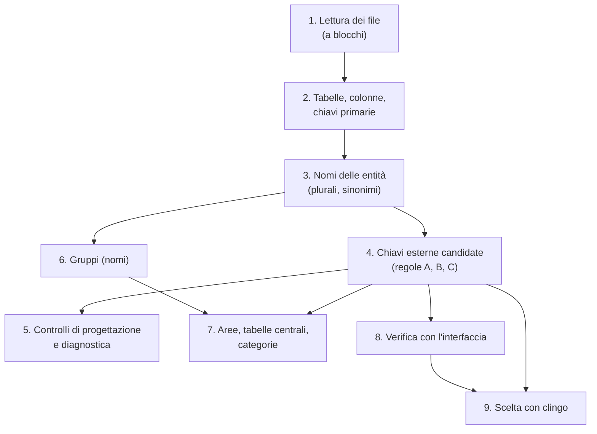

# 4. Come funziona

[Indice](README.md) · Precedente: [Guida all'uso](03-guida-all-uso.md) · Successivo: [Diagnostica](05-diagnostica.md)

Tutte le decisioni del programma vengono da regole precise: nessuna intelligenza artificiale, nessun servizio esterno. Questo capitolo spiega le regole nell'ordine in cui vengono applicate.

## 1. Lettura dei file

Il file si legge **a blocchi da 16 MB**, senza caricarlo tutto in memoria (`sqlfk/lettura.py`). Un'espressione regolare trova la fine di ogni istruzione saltando stringhe (anche con `\'` di MySQL), nomi tra virgolette, commenti (`--`, `/* */`, `#` in MySQL), blocchi `$$` di PostgreSQL, righe `GO` di SQL Server, e i dati dei `COPY ... FROM stdin` fino alla riga `\.`. La codifica si riconosce dal BOM (UTF-8, UTF-16).

- File **fino a 64 MB**: si tengono interi.
- File **più grandi**: si tiene solo la **struttura** (CREATE TABLE, ALTER TABLE, indici, viste...) e si saltano i dati (`INSERT`, `REPLACE`, `COPY`). Una **mappa delle righe** riporta ogni riga del testo ridotto alla riga del file originale: errori e avvisi indicano sempre la riga vera.

Velocità indicative su un portatile: 1 GB di dump PostgreSQL in circa 3 secondi, 1 GB di MySQL in circa 8, con circa 250 MB di memoria.

## 2. Tabelle, colonne, chiavi primarie

I `CREATE TABLE` si leggono con **sqlglot** (il dialetto si sceglie nelle Impostazioni); se sqlglot non riesce (sintassi particolari come `ENGINE=`, `PARTITION BY`, `COMMENT`) c'è un **parser di riserva** a espressioni regolari. Si leggono tipi, `NOT NULL`, `UNIQUE`, chiavi primarie e chiavi esterne, anche quelle aggiunte dopo con `ALTER TABLE` (tipico dei dump di PostgreSQL). Gli schemi `public`, `dbo`, `main` si ignorano; gli altri restano nel nome (`vendite.ordini`).

Se una tabella **non dichiara la chiave primaria**, il programma la indovina: una colonna `id`, oppure una colonna che richiama il nome della tabella (`id_cliente` in `clienti`). Queste chiavi sono segnalate come "non dichiarate" (codice E010).

## 3. Nomi delle entità

Per capire che `clienti`, `tbl_cliente`, `ClientiRighe` parlano della stessa entità:

- si tolgono prefissi tecnici (`tbl_`, `tab_`, `tmp_`...) e le parole che non indicano entità (Impostazioni);
- si spezzano i nomi in parole (`ordini_righe`, `OrdiniRighe` → `ordini`, `righe`);
- ogni parola si porta al **singolare**, in italiano (province → provincia, comuni → comune, banchi → banco) e in inglese (categories → category, addresses → address), senza accenti (città → citta);
- i **sinonimi** delle Impostazioni (`comune = citta`) fanno coincidere parole diverse.

Due nomi indicano la stessa entità se hanno almeno una di queste forme in comune.

## 4. Chiavi esterne candidate

Per ogni colonna (tranne quelle **generiche** come `id`, `nome`, `note`, `data`...):

| Regola | Quando | Affidabilità |
|---|---|---|
| **A. Stesso nome della chiave primaria** | la colonna ha lo stesso nome (normalizzato: maiuscole, `_` e spazi non contano) della chiave primaria di un'altra tabella: `fatture.id_cliente` → `clienti.id_cliente` | alta |
| **B. Il nome richiama una tabella** | il nome della colonna contiene il nome di un'entità (`id_articolo`, `articolo_id`, `cod_articolo`, `articoloId` → `articoli`) ma non coincide con la sua chiave | media |
| **C. Chiave composta** | la tabella contiene tutte le colonne della chiave primaria composta di un'altra: `spedizioni_righe(id_ordine, num_riga)` → `ordini_righe` | alta |

Per ogni candidata si controllano anche:

- **tipi**: uguali, compatibili (`INT` / `BIGINT`, `VARCHAR(30)` / `TEXT`) o diversi;
- **relazione**: 1:1 se la colonna è anche `UNIQUE` o è tutta la chiave primaria della figlia, altrimenti 1:N;
- **obbligatoria**: tutte le colonne `NOT NULL`.

Le colonne che sembrano chiavi (`id_qualcosa`) ma non hanno una tabella a cui collegarsi vanno tra le "sospette" (W033). Le **colonne con nomi simili** (`CODART` / `Cod_Articolo`) si trovano con la somiglianza delle stringhe (soglia nelle Impostazioni, predefinita 0,85).

Le **chiavi primarie composte** si analizzano anche colonna per colonna: per ogni colonna si cerca la tabella con il nome del campo (`codice` → `codici`) e si verifica se lì il campo esiste ed è chiave primaria.

## 5. Controlli di progettazione

Dalla sola struttura (senza i dati) si controllano le regole della progettazione relazionale:

- **integrità dell'entità**: chiave primaria presente e valida;
- **integrità referenziale**: le chiavi dichiarate puntano a tabelle e colonne esistenti, alla chiave primaria (o a una colonna `UNIQUE`), con tipi uguali; MyISAM e tabelle partizionate in MySQL;
- **tabelle ponte**: chiave primaria composta da chiavi esterne verso tabelle diverse = relazione N:M;
- **prima forma normale**: campi composti (`indirizzo_completo`, `generalita`), gruppi di colonne ripetute (`telefono1`, `telefono2`), tipi non atomici (`SET`, `JSON`, `ARRAY`);
- **seconda forma normale**: in una chiave composta, una colonna che dipende da una parte sola (`citta_fornitore` in `forniture(id_fornitore, id_articolo)`);
- **terza forma normale**: una colonna che dipende da un'altra non chiave (`ragione_sociale` in `fatture` accanto a `id_cliente`);
- **relazioni ridondanti**: X → Z quando c'è già un percorso X → Y → Z.

Tutto diventa la **diagnostica** (vedi [Diagnostica](05-diagnostica.md)).

## 6. Gruppi (sottogruppi)

Le tabelle si raggruppano per somiglianza dei nomi con un **clustering gerarchico** (legame medio, scipy). La somiglianza tra due tabelle è la quota delle loro parole in comune (dopo singolari e sinonimi), oppure, per nomi attaccati, la quota di inizio comune della prima parola (`anagrafica` / `anagrafiche`). Il dendrogramma si taglia alla soglia dei gruppi delle Impostazioni (predefinita 0,75). Il nome del gruppo è la parola più frequente e più corta.

## 7. Aree, tabelle centrali e categorie

**Aree.** Si costruisce un grafo dove i nodi sono i gruppi e gli archi le chiavi esterne tra gruppi (dichiarate e trovate ad affidabilità alta). Le **comunità** si trovano con la modularità (algoritmo greedy di networkx): gruppi con molti collegamenti tra loro e pochi con il resto formano un'area. L'area prende il nome del gruppo con più collegamenti.

**Tabelle centrali.** Una tabella puntata da molte altre (almeno 4 o il 10% delle tabelle collegate) di almeno 3 gruppi diversi, come una tabella `collection` presente in tutte le chiavi, unirebbe tutto in un'unica area: i suoi archi pesano 0,1 invece di 1 e la tabella va nell'area a cui è più legata.

**Categorie** (ricavate dalla struttura, da verificare):

| Categoria | Regola |
|---|---|
| storico | il nome contiene log, storico, history, audit, archivio... |
| isolata | nessuna chiave esterna verso altre tabelle o da altre tabelle |
| ponte | tabella ponte di una relazione N:M |
| dettaglio | punta a un'altra tabella e la sua chiave contiene quella del padre (righe di un ordine), o il nome contiene righe, dettagli, items... |
| movimento | ha una data (non generica) e punta ad almeno un'entità vera (non solo a codifiche) |
| codifica | è solo puntata, ha al massimo 3 colonne, oltre alla chiave solo testi (sigla, descrizione) |
| anagrafica | è puntata da altre tabelle |
| dipendente | punta ad altre tabelle, ma nessuna punta a lei |

## Reverse engineering: descrizione delle tabelle

`sqlfk/descrizione.py` descrive ogni tabella con regole:

- **nome leggibile**: le parole del nome al singolare quando è sicuro (le stesse regole dell'ontologia: `comuni` → comune, `ordini_righe` → riga di ordine);
- **categoria** dal punto 7; in più una tabella con *righe*, *dettagli*, *items*... nel nome diventa *dettaglio* della tabella che ha il nome della prima parola (`ordini_righe` → `ordini`), anche se la chiave esterna non è sicura;
- **collegamenti**: le chiavi dichiarate e quelle trovate ad affidabilità alta, senza le ridondanti (come il diagramma); le altre candidate diventano *possibili riferimenti*;
- **significato delle colonne** dalle **parole** del nome (non da pezzi qualsiasi: `pathogenicity` non è una città) e dal tipo: data, importo, quantità, stato, tipologia, nome o descrizione (anche la colonna con lo stesso nome della tabella, come `regioni.regione`), recapito, codice (prima degli importi: `partita_iva` è un codice), indicatore sì/no, file o allegato, posizione, note, utente, versione;
- una **frase per categoria**, sempre come ipotesi ("probabilmente").

Il **filo logico** ordina le tabelle di ogni area con un ordinamento topologico: prima quelle senza padri nell'area (a parità: tabelle centrali, poi anagrafiche, elenchi, movimenti, dettagli, ponti, storici), poi via via quelle che dipendono da tabelle già elencate; i cicli si sciolgono partendo dalla tabella più usata.

## File della cartella e file XML

`sqlfk/esplora.py` lavora in sola lettura sulla cartella caricata (o su quella scelta nella pagina):

- l'**elenco** percorre le sottocartelle saltando quelle che non servono (`.git`, `node_modules`, `__pycache__`, ambienti virtuali), fino a 50.000 file;
- ogni percorso chiesto dall'interfaccia è **relativo alla cartella** e viene controllato: non si può leggere niente fuori (`../`);
- la **lettura** è a pezzi da 512 KB che finiscono a fine riga, così il pezzo dopo riparte da una riga intera; una riga più lunga di un pezzo si mostra lo stesso, divisa. La **codifica** si riconosce dai primi byte: BOM UTF-8 o UTF-16, UTF-16 senza BOM (uno zero ogni due byte), UTF-8 valido, altrimenti Windows-1252. Un file con byte zero (e non UTF-16) è **binario**;
- la **ricerca nel contenuto** legge i file fino a 32 MB e restituisce, per ogni file, quante volte compare la parola e le prime 20 righe;
- le **tabelle di un file `.sql`** vengono dall'analisi (file e riga di ogni `CREATE TABLE`); per i file non caricati l'interfaccia le cerca nel testo.

I file **XML** si leggono interi (fino a 64 MB) e si analizzano nell'interfaccia con il parser XML del motore web, che non scarica risorse esterne. Le tabelle del database si riconoscono confrontando le **parole** (lettere, cifre e `_`) di nomi di elementi, nomi e valori degli attributi e testi brevi con i nomi delle tabelle; le **colonne** si cercano solo nell'elemento che nomina la tabella e nei suoi discendenti (fino a 300), così `id` o `nome` non si attribuiscono a caso.

## Estensioni: dati, viste e procedure, codice generato

`sqlfk/estensioni.py` usa solo i risultati dell'analisi e il database delle query (SQLite), in sola lettura.

- **Chiavi verificate sui dati.** Per ogni collegamento A.x → B.y (dichiarato, o candidato ad affidabilità alta e media) si contano le righe di A con x non NULL e quelle per cui `NOT EXISTS (SELECT 1 FROM B WHERE B.y = A.x)`, e lo stesso sui valori diversi; le chiavi composte si confrontano su tutte le colonne insieme. Esito dalla percentuale trovata: 100% confermata, almeno 95% pochi orfani, almeno 50% dubbia, sotto probabilmente sbagliata.
- **Collegamenti dai valori.** Per le chiavi primarie su una colonna e le colonne UNIQUE (intere o di testo) si leggono i valori diversi; ogni altra colonna della stessa famiglia di tipo, non già collegata e non chiave della sua tabella, con almeno 10 valori diversi, è un collegamento se tutti i suoi valori sono nella chiave. È *forte* se i valori non sono una breve sequenza di numeri piccoli e se, tra le chiavi che la contengono, è quella coperta meglio (5001-5300 stanno anche in 1-200000).
- **Profilo.** Una query di aggregazione per tabella (`COUNT`, `COUNT(DISTINCT)` per colonna). Le chiavi primarie e le colonne collegate non sono mai proposte come ENUM o chiavi naturali; servono almeno 20 valori.
- **Matrice CRUD.** Si trovano le intestazioni `CREATE VIEW / PROCEDURE / FUNCTION / TRIGGER` e il corpo (`$$...$$`, `BEGIN...END` contando i blocchi annidati, `DELIMITER` di MySQL, `GO` di SQL Server, `/` di Oracle). Da ogni `SELECT/INSERT/UPDATE/DELETE/MERGE` del corpo si prova il pezzo più lungo che sqlglot sa leggere e si guarda nell'albero sintattico il nodo padre di ogni tabella: destinazione di un INSERT = C, di un UPDATE = U, di un DELETE = D, il resto = R. Il codice procedurale che sqlglot non legge si analizza con espressioni regolari; `SELECT ... INTO variabile` non è una tabella.
- **Codice generato.** I tipi SQL diventano tipi SQLAlchemy (`VARCHAR(80)` → `String(80)`, `TINYINT(1)` → `Boolean`, `ENUM(...)` → `Enum`); lo script di normalizzazione prende le righe 1NF/2NF/3NF della qualità dello schema e scrive per ognuna le istruzioni nel dialetto scelto.

## 8. Verifica con l'interfaccia del programma

**Lettura (solo Windows, `sqlfk/finestre.py`).** Con **UI Automation** (la tecnologia dei lettori di schermo) si legge l'albero dei controlli della finestra scelta: per ogni controllo tipo (campo, menu a tendina, griglia, scheda...), nome, etichetta collegata, valore, voci del menu, intestazioni e righe delle griglie. Le password non si leggono. *Leggi tutte le schede* seleziona una dopo l'altra le schede e le voci degli alberi di navigazione (come un clic per spostarsi), mai pulsanti o comandi; i menu a tendina chiusi si aprono e richiudono solo per leggerne le voci. Ogni schermata diventa una **fotografia**: moduli con i campi, tabelle, coppie "etichetta: valore".

**Classi (`sqlfk/interfaccia.py`).** Ogni elenco, modulo o scheda è una vista di un'entità; le viste della stessa tabella sono la stessa **classe**. Una vista si collega alla tabella con il punteggio più alto:

- **2 punti** se il nome della vista o della schermata indica la tabella (stesse regole dei nomi del punto 3);
- **fino a 3 punti** per la quota di attributi che sono colonne della tabella (`Collection ID` → `collectionid`, anche al plurale o quasi uguali);
- **fino a 2 punti** se il database delle query è pronto: quota dei valori mostrati che si trovano davvero nelle colonne.

Serve almeno 1 punto.

**Relazioni mostrate.** Gli indizi, dal più forte al più debole:

| Indizio | Esempio | Forza |
|---|---|---|
| menu a tendina | nel modulo di una provincia, il menu *Regione* fa scegliere una regione | forte |
| valori | la colonna *Provincia* di un elenco di comuni mostra valori che sono record di `province` (controllati sui dati) | forte |
| link | la cella porta alla schermata di un'altra entità (nelle interfacce web) | forte |
| elenco nella scheda | dentro la scheda di un piatto c'è l'elenco dei suoi ingredienti (figli dentro il padre; se c'è una tabella ponte è una relazione N:M) | forte |
| nome | un campo ha il nome di un'altra entità e corrisponde a una colonna | debole |

**Verifica.** Ogni relazione mostrata si confronta con le chiavi dichiarate e con le candidate: *dichiarata*, *prevista* (confermata), *N:M tramite una tabella ponte*, *mancata* (il programma la usa ma l'analisi no). Per le candidate: *confermata dall'interfaccia*, *indizio debole*, *non vista* (le due tabelle si vedono ma il collegamento no), *non verificabile* (tabelle mai viste).

- **Precisione** = candidate confermate / candidate verificabili (con le due tabelle viste nel programma).
- **Richiamo** = relazioni forti del programma (non già dichiarate) che l'analisi aveva previsto / tutte le relazioni forti del programma.

Il **racconto** trasforma ogni relazione in una frase ("il menu a tendina «Regione» del modulo «Provincia» fa scegliere un record di regioni: ogni provincia è collegata a una regione..."), raggruppata per schermata, con l'SQL per quelle mancate.

## 9. Scelta con clingo (ASP)

**clingo** è un risolutore di *Answer Set Programming*: si descrive il problema con fatti e regole logiche e clingo trova la soluzione migliore. Qui risolve un problema che le regole del punto 4 lasciano aperto: le candidate sono spesso **in conflitto** (le stesse colonne verso tabelle diverse), creano **ridondanze** o **cicli**, oppure hanno tipi incompatibili. clingo sceglie l'insieme più coerente.

**Fatti** (`sqlfk/asp.py`): per ogni candidata, tabella figlia e padre, colonne, e gli indizi: dichiarata, affidabilità alta o media, tipi diversi, confermata o debole nell'interfaccia, vista solo nell'interfaccia, parte di una tabella ponte, scorciatoia (X → Z quando ci sono anche X → Y e Y → Z), stessa chiave (figlia e padre hanno la stessa chiave primaria), padre centrale.

**Regole** (`sqlfk/regole_fk.lp`, leggibile e modificabile):

- le chiavi **dichiarate** si scelgono sempre;
- le **stesse colonne** puntano al massimo a una tabella;
- **due tabelle non si puntano a vicenda**, e una tabella non punta a se stessa (salvo chiavi dichiarate o confermate);
- una relazione **ridondante** (X → Z con X → Y → Z già scelte) è penalizzata;
- **pesi** da massimizzare:

| Indizio | Peso |
|---|---|
| confermata dall'interfaccia | +6 |
| affidabilità alta | +3 (+2 se scorciatoia) |
| vista solo nell'interfaccia | +3 |
| affidabilità media | +1 (solo se si includono le medie) |
| indizio debole nell'interfaccia, parte di una tabella ponte, padre centrale | +1 |
| tabelle con la stessa chiave (direzione incerta), se non confermata | −1 |
| tipi diversi, se non dichiarata né confermata | −3 |
| ridondante | −4 |

Una scorciatoia vale meno di un percorso: così, se c'è ridondanza, clingo toglie la scorciatoia e non un pezzo del percorso. clingo cerca l'**ottimo** (e dice se l'ha dimostrato; su database molto grandi si ferma dopo 30 secondi con la migliore soluzione trovata).

**Spiegazioni.** Per ogni candidata scartata il motivo: *le stesse colonne puntano già a X*, *ridondante: c'è già X → Y → Z*, *renderebbe ridondante X → Z già scelta*, *c'è già Y → X*, *stessa chiave primaria: direzione incerta, da confermare con l'interfaccia*, *tipi non compatibili*. Si vedono anche le **differenze** con la scelta automatica (dichiarate più la migliore candidata ad affidabilità alta per colonna). Il programma ASP con i fatti si scarica e si può risolvere anche con `clingo` da terminale, ottenendo lo stesso risultato.

## 10. Query sui dati

Dai file si costruisce un database **SQLite**: le tabelle dei CREATE TABLE (più le colonne di `ALTER TABLE ... ADD COLUMN`) e i dati degli `INSERT` e dei `COPY`. Le stringhe di MySQL (`\'`, `0x...`, `_binary`) e di SQL Server (`N'...'`) si convertono; i casi difficili si traducono con sqlglot.

- Fino a 256 MB di dati il database sta **in memoria**; oltre, è un **file su disco** in `~/.sqlfk/cache` (o nella cartella della variabile `SQLFK_CACHE`), costruito una volta e riaperto subito le volte dopo se file, schema e dialetto non sono cambiati (impronta SHA-1).
- La costruzione richiede circa 30 secondi per GB per i dump PostgreSQL e 70 per quelli MySQL; si può interrompere.
- Le istruzioni nel **corpo di procedure, funzioni e trigger** (`INSERT`, `DELETE`... tra `BEGIN` ed `END`, anche con `DELIMITER` di MySQL, fino a `GO` in SQL Server, fino a `/` in Oracle) non sono dati e non si caricano: si contano i blocchi `BEGIN`/`CASE` aperti e chiusi; i corpi `$$ ... $$` di PostgreSQL restano interi.
- Le query dell'utente si eseguono così come sono; se SQLite non le capisce si traducono dal dialetto dei file. I nomi con lo schema si riportano alle tabelle.
