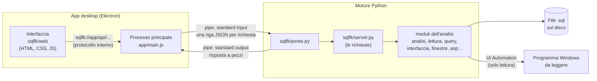
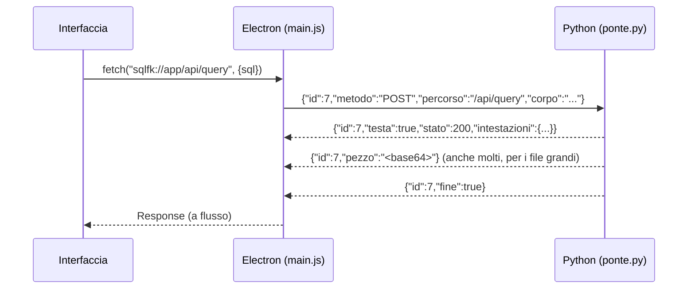
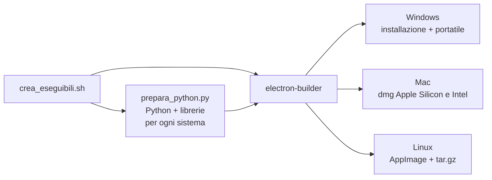

# 6. Architettura

[Indice](README.md) · Precedente: [Diagnostica](05-diagnostica.md) · Successivo: [Riga di comando](07-riga-di-comando.md)

## Le parti e come comunicano

1. L'**interfaccia** è una pagina web (`sqlfk/web`) mostrata da Electron. Si carica dall'indirizzo interno `sqlfk://app/` e chiama le funzioni del motore con richieste come `fetch("/api/stato")`.
2. Il **processo principale** di Electron (`app/main.js`) riceve queste richieste attraverso il **protocollo interno** `sqlfk://` e le passa al motore Python.
3. Il **motore Python** (`python -m sqlfk.ponte`) le riceve sullo **standard input**, una riga JSON per richiesta, e risponde sullo **standard output** con la testa (stato, intestazioni) e i dati a pezzi. Le richieste sono servite dallo stesso codice del server (`sqlfk/server.py`), che chiama i moduli dell'analisi.
4. I **moduli** leggono i file `.sql` dal disco e, per la verifica, le finestre del programma con UI Automation.

### Una richiesta, passo per passo

Le risposte sono **a flusso**: un download da molti GB (database SQLite, CSV completo) passa a pezzi e finisce direttamente nel file scelto, senza riempire la memoria. Più richieste possono essere in corso insieme (il motore usa più thread); i lavori lunghi (lettura di file grandi, costruzione del database delle query, lettura di tutte le schede) girano in background e l'interfaccia ne segue l'avanzamento.

## Perché non usa la rete

L'app **non apre porte e non usa internet**:

- l'interfaccia si carica dal protocollo interno `sqlfk://app/`, non da un indirizzo web;
- Electron e Python si parlano con le **pipe del processo** (standard input e output), non con una connessione;
- ogni richiesta verso `http`, `https`, `ws`, `wss`, `ftp` è **bloccata** da Electron, e la navigazione fuori dall'app è impedita;
- i servizi di rete in sottofondo di Chromium sono spenti;
- gli schemi grafici non caricano niente da internet (i riferimenti esterni di pyvis si tolgono);
- negli eseguibili **Python e tutte le librerie sono inclusi**: non si installa niente;
- la lettura del programma Windows usa le funzioni di accessibilità del sistema, sul computer stesso.

Il **controllo dell'app** lo verifica ogni volta che lo esegui (e da solo al primo avvio): prova una richiesta a internet (deve essere bloccata) e controlla con `lsof` (Mac, Linux) o `netstat` (Windows) che né Electron né Python abbiano connessioni aperte.

La modalità nel browser (`python -m sqlfk.server`) è diversa: usa un piccolo server su `127.0.0.1`, accessibile solo dal computer stesso. L'app non la usa.

## I moduli

| File | Compito |
|---|---|
| `sqlfk/analisi.py` | lettura dei CREATE TABLE, chiavi primarie, chiavi candidate, gruppi, aree, categorie, controlli di progettazione, diagnostica, Excel, script SQL |
| `sqlfk/lettura.py` | lettura a blocchi dei file `.sql` di qualsiasi dimensione, divisione in istruzioni, testo ridotto con la mappa delle righe |
| `sqlfk/query.py` | database SQLite costruito dai file (in memoria o su disco, con cache), esecuzione e traduzione delle query, CSV completo |
| `sqlfk/finestre.py` | lettura delle finestre di un programma Windows con UI Automation; conversione in fotografie |
| `sqlfk/interfaccia.py` | dalle fotografie: classi, collegamento a tabelle e colonne, relazioni, verifica, racconto e mappa |
| `sqlfk/asp.py`, `sqlfk/regole_fk.lp` | scelta delle chiavi esterne con clingo |
| `sqlfk/controllo.py` | il controllo dell'app (in Python) |
| `sqlfk/regole.py` | le regole di progettazione R0-R8 e le spiegazioni dei codici |
| `sqlfk/modello.py` | struttura del diagramma, modello relazionale ed esportazioni |
| `sqlfk/ontologia.py` | ontologia OWL e mapping R2RML |
| `sqlfk/grafici.py` | schemi a grafo (pyvis) |
| `sqlfk/server.py` | le richieste dell'interfaccia (`/api/...`), lo stato della sessione, i lavori in background; anche server HTTP locale per il browser |
| `sqlfk/ponte.py` | collegamento con l'app tramite pipe |
| `sqlfk/verifica.py` | diagnostica da terminale |
| `sqlfk/web/` | l'interfaccia: `index.html`, `app.js` (pagine), `diagramma.js` (diagramma delle tabelle), `editor.js` (editor), `style.css` |
| `app/main.js`, `app/preload.js` | l'app Electron: avvio di Python, protocollo interno, blocco della rete, controllo, salvataggio dei rapporti |
| `app/prepara_python.py` | prepara il Python con le librerie da includere negli eseguibili |
| `crea_eseguibili.sh`, `.bat` | creano gli eseguibili |
| `collegamenti_tabelle_sql.ipynb` | il notebook, che usa gli stessi moduli |

## Le richieste del motore (`/api/...`)

Usate dall'interfaccia; nel browser si possono chiamare anche a mano.

| Gruppo | Richieste |
|---|---|
| caricamento | `carica_cartella`, `carica_percorsi`, `carica_file`, `lavoro`, `lavoro/ferma`, `progetto` |
| analisi | `stato`, `panoramica`, `diagnostica`, `regole`, `tabelle`, `pk_composte`, `fk`, `altri`, `qualita`, `gruppi`, `aree`, `sorgente`, `cerca_entita` |
| modifiche | `togli`, `togli_gruppo`, `rimetti`, `impostazioni` |
| schemi | `diagramma`, `modello`, `schema_iniziale`, `schema_collegamenti`, `ontologia` |
| query | `query/tabelle`, `query`, `query/csv`, `query/interrompi`, `query/costruisci`, `query/ricostruisci`, `query/svuota_cache` |
| interfaccia | `finestre`, `finestre/leggi`, `finestre/leggi_tutto`, `finestre/registra`, `finestre/ferma`, `interfaccia`, `interfaccia/pagina`, `interfaccia/analisi`, `interfaccia/svuota` |
| clingo | `asp` |
| controllo | `autoverifica` |
| download | `scarica/excel`, `scarica/sql`, `scarica/create`, `scarica/report`, `scarica/ontologia`, `scarica/r2rml`, `scarica/database_sqlite`, `scarica/database_sql`, `scarica/interfaccia`, `scarica/asp_sql`, `scarica/asp_lp` |

## Gli eseguibili

- **Python incluso**: per Windows il Python *embeddable* ufficiale di python.org (3.12.10), per Mac e Linux le build di *python-build-standalone* (3.12.15, versione fissa), con le librerie già compilate (wheel) per ogni sistema: pandas, scipy, sqlglot, pyvis, openpyxl, networkx, clingo e, per Windows, comtypes. Si tolgono le parti non usate (Tk, IDLE, test).
- Nell'app il modulo `sqlfk` e gli esempi stanno tra le **risorse**; l'app cerca prima il Python incluso, poi (in sviluppo) quello del computer.
- Gli eseguibili **non sono firmati** (vedi [Installazione e avvio](02-installazione-e-avvio.md)).

## Dati salvati dall'app

| Cosa | Dove |
|---|---|
| Progetti | dove li salvi tu (`.sqlfk`, JSON con file letti, impostazioni, tabelle tolte, disposizione, modello dell'editor, schermate lette) |
| Rapporti della verifica con l'interfaccia | `Documenti/SQL FK Finder/rapporti/<programma data>/` |
| Risultato del controllo dell'app | `autoverifica.txt` nella cartella dei dati dell'app |
| Database delle query su disco | `~/.sqlfk/cache` (o `SQLFK_CACHE`) |
| Ambiente dell'app (impostazioni di Electron) | cartella dei dati dell'app (`SQL FK Finder`) |

I file `.sql` non vengono mai modificati.
