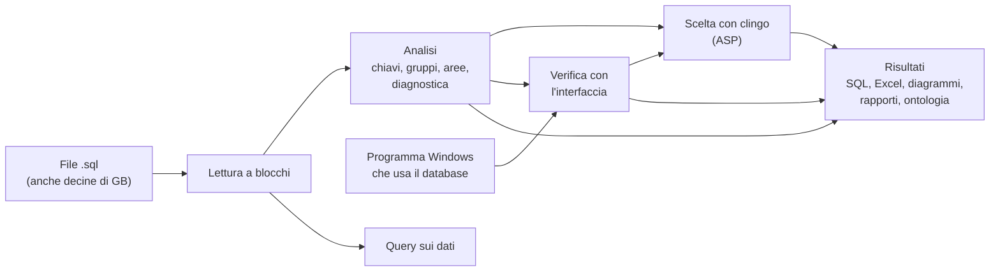

# Documentazione di SQL FK Finder

SQL FK Finder legge i file `.sql` di un database e trova i **collegamenti mancanti tra le tabelle** (le chiavi esterne che non sono state dichiarate). Controlla anche la qualità della progettazione, permette di interrogare i dati e verifica le previsioni guardando l'**interfaccia grafica del programma** che usa il database. Gira **tutto sul tuo computer**: niente internet, niente servizi esterni, niente intelligenza artificiale.

**Manuale d'uso in PDF**: [Manuale_SQL_FK_Finder.pdf](Manuale_SQL_FK_Finder.pdf) (29 pagine, con gli screenshot di ogni pagina dell'app): da stampare o consegnare a chi usa il programma.

## Indice

| | Capitolo | Cosa trovi |
|---|---|---|
| 1 | [Introduzione](01-introduzione.md) | a cosa serve, cosa fa, cosa non fa, i concetti di base |
| 2 | [Installazione e avvio](02-installazione-e-avvio.md) | eseguibili per Windows, Mac e Linux, avvio dai sorgenti, notebook, controllo dell'app |
| 3 | [Guida all'uso](03-guida-all-uso.md) | tutte le pagine dell'app, una per una, con un percorso di lavoro consigliato |
| 4 | [Come funziona](04-come-funziona.md) | le regole e gli algoritmi: chiavi esterne, gruppi e aree, file grandi, query, interfaccia, clingo |
| 5 | [Diagnostica: codici e regole](05-diagnostica.md) | tutti gli errori, avvisi e info, con la regola di progettazione e la correzione |
| 6 | [Architettura](06-architettura.md) | come comunicano le parti del software, perché non usa la rete, i moduli, gli eseguibili |
| 7 | [Riga di comando](07-riga-di-comando.md) | i comandi da terminale e le loro opzioni |
| 8 | [Domande frequenti e problemi](08-domande-frequenti.md) | i problemi più comuni e come risolverli |

## In breve

- **Branch `main`**: il programma delle chiavi esterne (analisi, diagnostica, diagrammi, query, file grandi, eseguibili).
- **Branch `verifica-interfaccia`**: tutto quello di `main` più la verifica con l'interfaccia di un programma Windows, la scelta con clingo, l'app senza rete e con Python incluso, il controllo automatico dell'app. Questa documentazione descrive questa versione.
